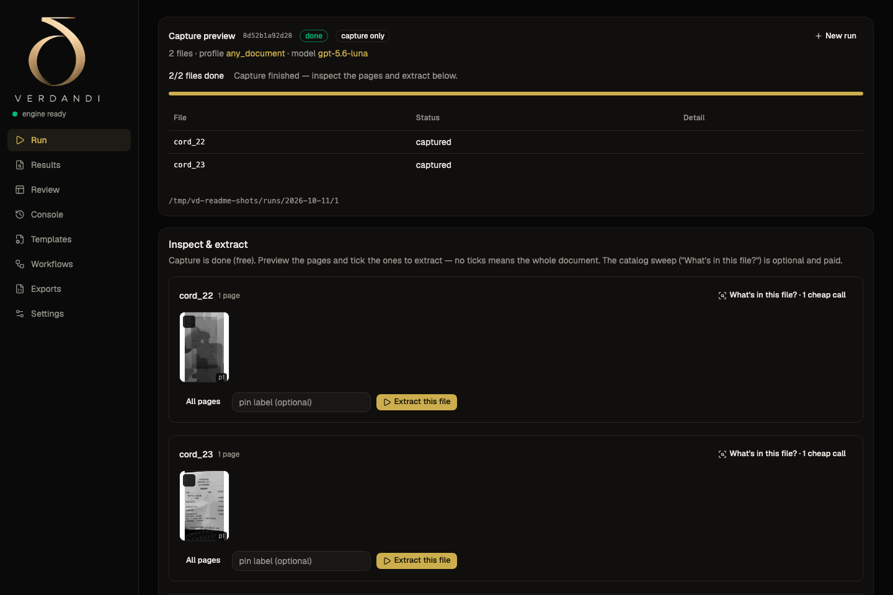
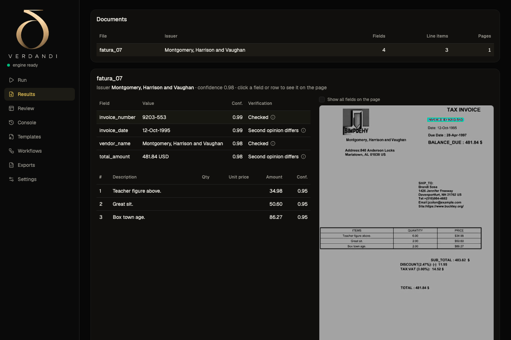
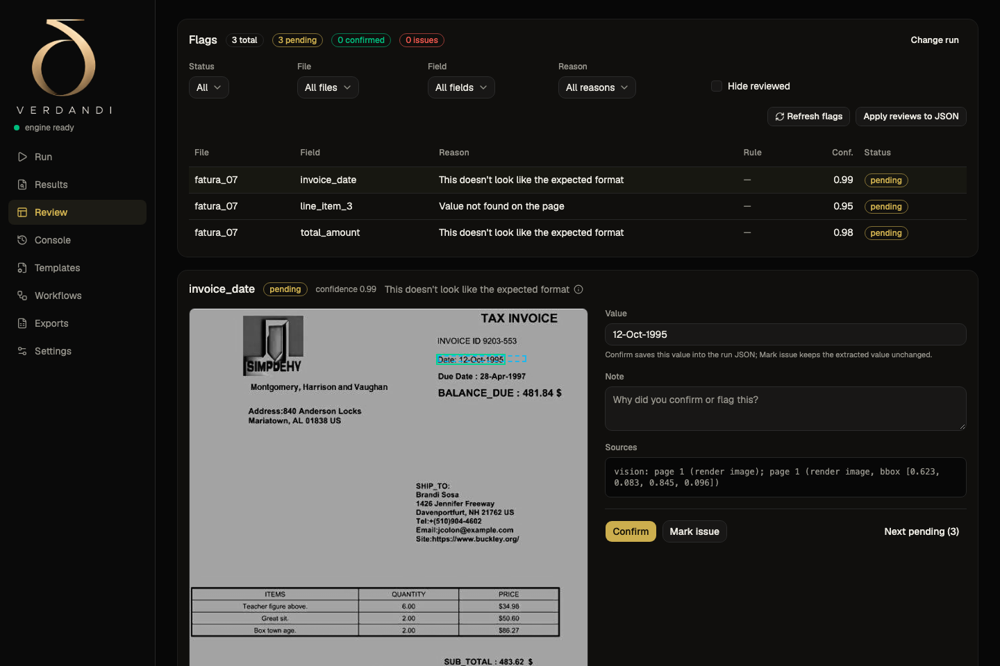
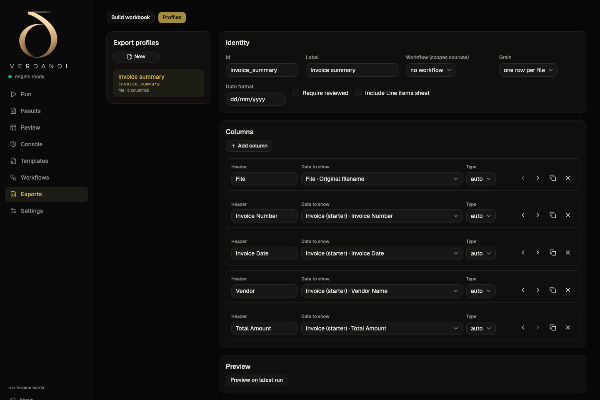
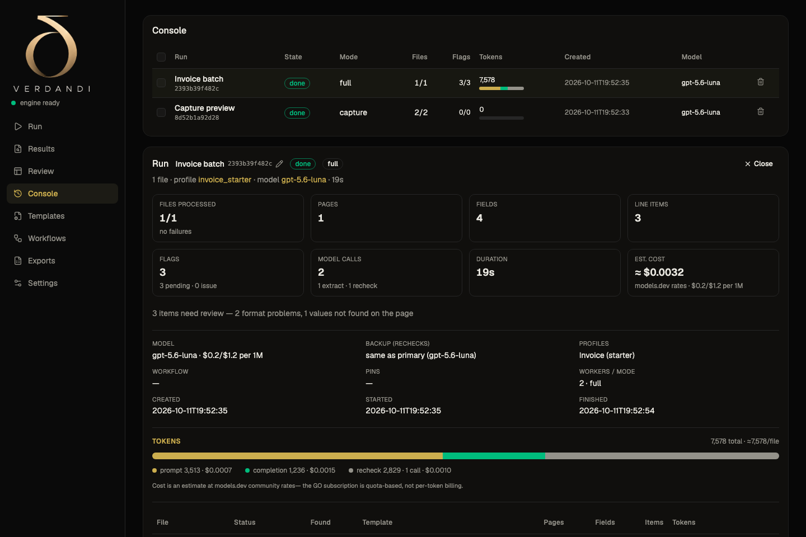

# Verdandi

**Read documents with vision AI, verify every value locally, and export a
clean workbook.**

Verdandi is a local-first document extraction engine and desktop app. Point
it at PDFs — freight invoices, bills of entry, air waybills, receipts, or any
other document — and it captures the pages, reads them with one vision model
call, checks the result with a deterministic local verification stack, and
flags anything doubtful for human review.



## Why it is different

- **Vision-primary, one call per document.** The model sees the page and
  reports what is printed; no brittle template matching, no regex field
  extraction. New layouts work zero-shot.
- **A deterministic guard, not a second extractor.** Grounding (is the value
  near the claimed region?), arithmetic (do the rows and totals add up?),
  format validation, and a gated disagreement check run locally and free.
  Values are never silently corrected — only flagged.
- **Local-first.** Runs, renders, extracted data, reviews and exports stay on
  your machine. The only cloud call is the page image sent to the model
  provider **you** configure with **your own key**.
- **Built for bulk.** One paid call per attachment, parallel workers, resumable
  runs, workflows that bundle several document kinds, and cross-document
  checks (for example, a Bill of Entry number must match across documents).

## Screenshots

| Results with evidence | Review a flag |
|---|---|
|  |  |

| Build an export | Run history |
|---|---|
|  |  |

## Quickstart

Requirements: **Python 3.11+**. The desktop app also needs **Node 20+**; a
Rust toolchain is only required for the native window and packaged builds.
Capture uses Apple Vision on macOS (Xcode command-line tools) and the optional
cross-platform engine (pypdfium2 + RapidOCR) everywhere else.

### CLI

```sh
python3 -m venv .venv
.venv/bin/python -m pip install -r requirements.txt

# Windows / Linux / macOS without Xcode: add the cross-platform capture engine.
.venv/bin/python -m pip install -r requirements-crossplatform.txt

cp .env.example .env          # add OPENCODE_API_KEY (https://opencode.ai/auth)

mkdir -p my-pdfs              # put your own PDFs here
.venv/bin/python text_layer.py my-pdfs out/raw    # capture: renders + OCR + quality gate (free)
.venv/bin/python extract.py out/raw out/json      # one vision call per document (paid)
```

`extract.py --document <id>` picks the template from `rules/documents.yaml`
(run it with no `--document` to use the first one). The same pipeline drives
the app; `make new-run` + `make ocr-corpus` + `make extract-corpus` are the
corpus workflow used for development, and `make eval` scores a run against a
truth file.

Optional but recommended: `requirements-orientation.txt` adds the local
page-orientation classifier (offline, ~3 ms/page).

`invoices/` and the truth files are **not** in this repository — they are
private test data. The test suite self-skips the corpus assertions when they
are absent.

### Desktop app

Prebuilt installers (macOS Apple Silicon + Windows x64) are on the
[releases page](https://github.com/Akshay-M-Singh/verdandi-app/releases/latest).

To run it from source:

```sh
.venv/bin/python -m pip install -r requirements.txt -r desktop/requirements-desktop.txt
cd desktop && npm install && cd ..
make desktop-dev              # engine + interface -> http://localhost:5173
```

Or build the packaged app: `python desktop/build_sidecar.py` then
`cd desktop && npm run tauri build`. See `desktop/README.md` and
`desktop/RELEASING.md`.

## How it works

```
PDF
 └─ capture (local, free): page renders + text channel + quality gate + orientation
     └─ ONE vision call: document selection + structured extraction
         └─ verification (local, free):
              grounding · arithmetic · format · gated disagreement
              line-item row checks · duplicate/overlap backstops
              cross-document checks (workflows)
             └─ confidence thresholds -> review flags -> Excel export
```

The text channel never extracts values — it only proves or disputes what the
vision model claimed. The design and the full decision log are in
[`architecture.md`](architecture.md).

## Benchmark

On a 100-document benchmark (35 FATURA2 invoices, 25 CORD receipts, 10 Kaggle
scans, 30 synthetic documents), both systems zero-shot on identical PDF bytes,
two runs each. Verdandi at its best measured configuration (gpt-6-luna with
full-resolution renders; the shipped default is gpt-5.6-luna with images
capped at 1536 px), Azure Content Understanding on its best supported model
(GPT 5.5):

| | Verdandi | Azure Content Understanding |
|---|---|---|
| Field macro accuracy | **97.0%** (97.0 / 97.0) | 96.2% (96.3 / 96.1) |
| Line-item F1 | **0.958** | 0.947 |
| Documents found | 100/100 | 100/100 |
| Cost per run | **$0.2121** | $2.5523 (12.0×) |

Verdandi's cost is a gateway quota proxy; ACU's is billed spend. Truth is
AI-verified, not human-audited. The harness, truth data, every number and all
caveats are in [`benchmark/BENCHMARK-REPORT-2026-10-06.md`](benchmark/BENCHMARK-REPORT-2026-10-06.md).
The benchmark PDFs come from public CC BY 4.0 datasets; see
[`benchmark/data/NOTICE.md`](benchmark/data/NOTICE.md).

## Bring your own key

The shipped configuration uses the [opencode Zen](https://opencode.ai/auth)
gateway, but the model endpoint is data, not code: edit
[`config/models.yaml`](config/models.yaml) to point at any OpenAI-compatible
endpoint that supports vision. The app stores the key in the OS keychain;
the CLI reads `OPENCODE_API_KEY` from the environment or `.env`.

## Privacy

The app sends page images and the extraction prompt to the model provider you
configure. It has no telemetry, no analytics, no access check and no feedback
upload. Official builds check the public GitHub release feed for updates;
source builds can remove or change that endpoint. See
[`legal/PRIVACY.md`](legal/PRIVACY.md).

## Repository layout

| Path | What it is |
|---|---|
| `extract.py`, `text_layer.py` | capture + extraction entry points |
| `verify.py`, `grounding.py`, `validate.py`, `aggregate.py` | the local verification stack |
| `compare.py`, `containment.py` | normalization, matching and cross-checks |
| `export.py` | typed, colour-coded Excel workbooks |
| `engines/` | Apple Vision and cross-platform capture engines |
| `desktop/` | Tauri + React app and the local engine service |
| `rules/` | document profiles, workflows and export profiles (data, not code) |
| `config/` | models + thresholds |
| `benchmark/` | Azure CU comparison harness + data |
| `tests/` | offline tests (the private corpus is optional) |

## Development checks

```sh
make check                    # unit tests + CLI smoke + ignore assertions
make desktop-check            # offline desktop tests + UI build + engine smoke
cd desktop && npm run build   # TypeScript + Vite
```

Contributions are welcome — read [`CONTRIBUTING.md`](CONTRIBUTING.md) first.
Please report vulnerabilities privately via [`SECURITY.md`](SECURITY.md).

## License

Apache License 2.0 — see [`LICENSE`](LICENSE). Third-party components and
benchmark data are attributed in [`THIRD_PARTY_NOTICES.md`](THIRD_PARTY_NOTICES.md)
and [`NOTICE`](NOTICE).

The Verdandi name and logo are not licensed for use as trademarks under
Apache-2.0 (Section 6); forks are welcome but should not imply endorsement.
